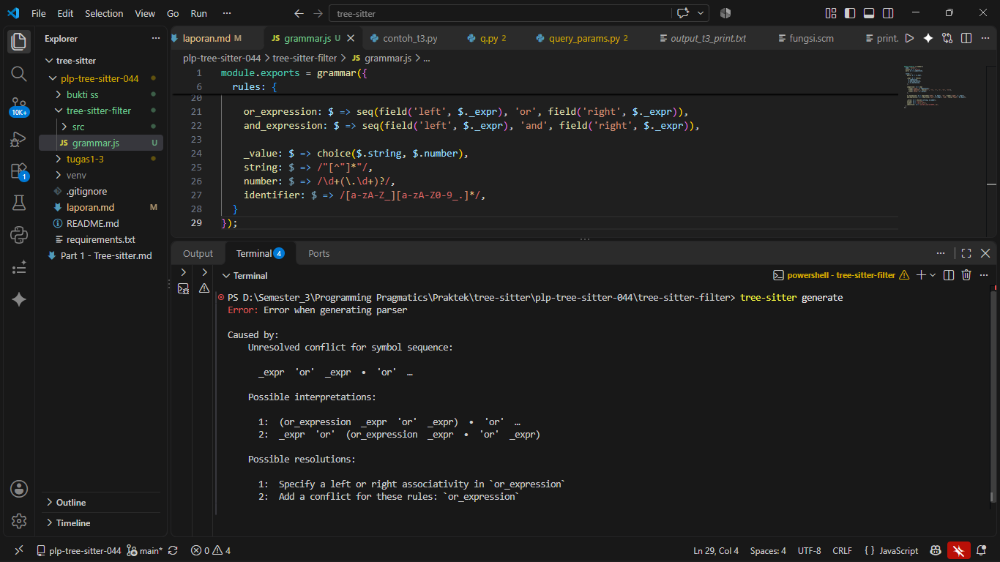
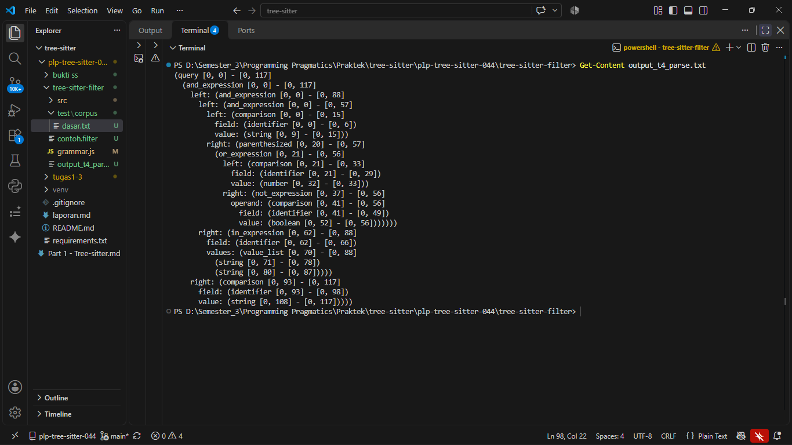

# Laporan Praktikum Tree-sitter
- **Nama:** Firliana Febrina
- **NIM:** 251524044
- **Kelas:** 1B D4 Teknik Informatika

---

## Tugas 1: Membaca Pohon Sintaks

### 1. Perkiraan Pohon (Tulisan Tangan) vs Hasil Sebenarnya


#### a. Potongan Fungsi (`def sapa(nama): return "Halo " + nama`)
* **Perkiraan Awal:**
  ```lisp
  (module
    (function_definition
      name: (identifier)
      parameters: (parameters (identifier))
      body: (block
        (return_statement
          (binary_operator left: (string) right: (identifier))))))

---

## Tugas 2: Penjelajah Node (`jelajah.py`)

### 1. Hasil Penelusuran Pohon
Program `jelajah.py` menelusuri node bernama secara rekursif (*preorder DFS*) menggunakan `enumerate(node.children)` untuk mengambil label `field_name_for_child(i)` serta posisi `start_point` (`baris + 1 : kolom`).


### 2. Kendala 
* **Kendala:** Jika melakukan perulangan langsung pada `node.named_children`, indeks yang dihasilkan tidak cocok dengan `node.field_name_for_child(i)` karena metode tersebut menghitung indeks dari `node.children` (termasuk node anonim). 
* **Solusi:** Melakukan iterasi pada `enumerate(node.children)` lalu memfilter dengan `if child.is_named:`.

---

## Tugas 3: Query & Pattern Matching (`.scm`)

### 1. Hasil Query & Verifikasi Manual
Pengujian dilakukan pada file `contoh_t3.py` menggunakan 3 pola query:
1. **Query Fungsi & Parameter (`fungsi.scm`):** Menggunakan `matches()` pada `QueryCursor` untuk memasangkan `@nama` dan `named_child_count` dari `@params`. Hasil: `sapa` (1), `hitung_luas` (3), dan `tanpa_param` (0) — cocok 100% dengan hitungan manual.
2. **Query Pemanggilan `print` (`print.scm`):** Menggunakan predikat `(#eq? @fn "print")`. Berhasil menangkap 3 pemanggilan `print(...)` pada baris 7, 12, dan 16 tanpa menangkap panggilan fungsi `sapa("Budi")` pada baris 18.
3. **Query Import Modul (`import.scm`):** Menangkap `(import_statement)` (termasuk `aliased_import` seperti `import sys as system`) dan `(import_from_statement)` dengan `module_name:`. Berhasil menangkap 4 modul (`os`, `sys`, `pathlib`, `typing`).


---

## Tugas 4: Grammar DSL Filter (`tree-sitter-filter`)

### 1. Rancangan Grammar & Uji Kasus
Grammar `filter` dibangun bertahap di `tree-sitter-filter/grammar.js` untuk mendukung ekspresi logika (`and`, `or`, `not`), tanda kurung, perbandingan (`=`, `!=`, `>`, `<`, `>=`, `<=`), operator `contains`, serta operator `in` dengan daftar nilai (`in_expression`). Sebanyak **6 kasus uji** ditulis di `test/corpus/dasar.txt` dan seluruhnya lulus pada pengujian `tree-sitter test`.





### 2. Kendala 
* **Kendala 1 (`Unresolved conflict`):** Saat menambahkan `or_expression` dan `and_expression` tanpa `prec.left`, `tree-sitter generate` menolak karena ambiguitas pengelompokan `a = 1 or b = 2 and c = 3`. **Solusi:** Memberikan `prec.left(1, ...)` untuk `or_expression` dan `prec.left(2, ...)` untuk `and_expression` agar `and` mengikat lebih kuat daripada `or`.
* **Kendala 2 (Keyword terbaca sebagai `identifier`):** Kata kunci `and` dan `or` sempat tertangkap sebagai `identifier`. **Solusi:** Menambahkan properti `word: $ => $.identifier` pada konfigurasi grammar.